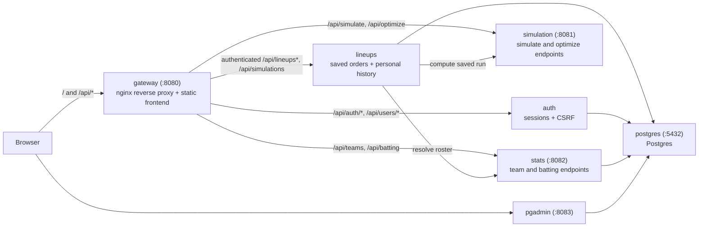

# Lineup Lab

Lineup Lab is a microservice-style baseball lineup simulator built to practice Go backend development, React frontend work, Docker-based local environments, and Kubernetes-oriented operational patterns.

## Local Architecture

The local Docker Compose stack has seven services:

- `gateway`
  - browser-facing reverse proxy on `http://localhost:8080`
  - serves the built frontend and exposes the single public `/api` surface
- `auth`
  - internal session, registration, login, logout, and CSRF verification API
- `lineups`
  - internal saved-lineup and personal simulation history API
- `stats`
  - Go API for roster and batting data on `http://localhost:8082`
- `simulation`
  - Go API for lineup simulation and optimization on `http://localhost:8081`
- `postgres`
  - Postgres database on `localhost:5432`
- `pgadmin`
  - Database admin UI on `http://localhost:8083`

### Architecture Diagram



Production-style local request flow:

1. The browser talks only to the gateway origin at `http://localhost:8080`
2. nginx in the gateway routes `/api/teams` and `/api/batting` to `stats`
3. nginx in the gateway routes `/api/simulate` and `/api/optimize` to `simulation`
4. `stats` reads batting data from Postgres
5. `auth` validates sessions and signed CSRF tokens; the gateway replaces identity headers before forwarding personal-resource requests to the private `lineups` service
6. `lineups` resolves canonical rosters through stats, persists user-owned batting orders, and records server-computed simulation results
7. `pgadmin` remains a separate local admin UI on `http://localhost:8083`

## Local Development

### 1. Create a local env file

Copy the example env file:

```sh
cp .env.example .env
```

The default `.env.example` values are set up for local development, but you should still update placeholder credentials such as:

- `POSTGRES_PASSWORD`
- `PGADMIN_DEFAULT_PASSWORD`
- `STATS_DATABASE_URL`
- `AUTH_DATABASE_URL`
- `LINEUPS_DATABASE_URL`

If you change the database credentials, keep `STATS_DATABASE_URL` in sync with them.

### 2. Start the stack with Docker Compose

```sh
docker compose up --build
```

This starts the full local environment with the gateway, both Go services, Postgres, and pgAdmin.

### 3. Open the app

- gateway and frontend app: [http://localhost:8080](http://localhost:8080)
- stat API: [http://localhost:8082/teams](http://localhost:8082/teams)
- simulation API: [http://localhost:8081/healthz](http://localhost:8081/healthz)
- pgAdmin: [http://localhost:8083](http://localhost:8083)

A fresh database includes **Demo Comets (Synthetic), 2024**, a roster of 12
fictional players with sample batting statistics. Select that team and year to
try the simulator. For an existing database, follow the
[repeatable demo import instructions](postgres/README.md#synthetic-demo-roster).

## Try the MVP

1. Open the app and register an account with a password of at least 15 characters.
2. Select **Demo Comets (Synthetic), 2024**. These 12 fictional hitters are seeded for first-run exploration.
3. Drag nine distinct hitters into batting-order slots. Click **Simulate** to try the current order and automatically record the result. Change the order and click again whenever you want.
4. Optionally enter a lineup name and choose **Save as new lineup** to keep a favorite combination. Saving is independent of simulation.
5. Refresh the page, select the saved lineup, and choose **Load selected lineup** to restore the ordered batting snapshot. Use **Update loaded lineup** to save further edits.
6. Inspect **My simulation history** for scores, sample counts, engine versions, and the exact batting order used. Personal practice results remain available after a saved lineup is edited or deleted.

Auth and lineups stay internal to Compose. The gateway authenticates each personal-resource request and checks signed CSRF on writes; storage queries additionally scope every resource to its owner. The UI clears private state when a session expires or the user logs out.

For existing database volumes, import demo data as documented in [postgres/README.md](postgres/README.md) and apply the saved-lineup and current-simulation migrations in order before starting the new service:

```sh
for migration in postgres/migrations/20261028190000_lineups_create_saved_lineups.sql postgres/migrations/20261028230000_lineups_create_simulation_runs.sql postgres/migrations/20261029190000_lineups_allow_current_simulations.sql; do
  docker compose exec -T postgres sh -c 'psql -v ON_ERROR_STOP=1 -U "$POSTGRES_USER" -d "$POSTGRES_DB"' < "$migration"
done
```

Fresh empty databases receive the same schema during bootstrap. Never delete an existing volume to apply these changes.

## Configuration

Key local environment variables:

### Database

- `POSTGRES_DB`
- `POSTGRES_USER`
- `POSTGRES_PASSWORD`
- `STATS_DATABASE_URL`

### Sessions

- `SESSION_HMAC_SECRET`: set a long random secret
- `SESSION_COOKIE_SECURE`: false for local HTTP, true when served over HTTPS

### Service ports

- `AUTH_PORT` (internal only)
- `LINEUPS_PORT` (internal only)
- `STATS_PORT`
- `STATS_HOST_PORT`
- `SIMULATION_PORT`
- `SIMULATION_HOST_PORT`

### Service behavior

- `STATS_ALLOWED_ORIGIN`
- `SIMULATION_ALLOWED_ORIGIN`
- `SIMULATION_DEBUG`

### Database admin

- `PGADMIN_DEFAULT_EMAIL`
- `PGADMIN_DEFAULT_PASSWORD`

Notes:

- `docker-compose.yml` requires several env vars explicitly and fails fast if they are missing
- the browser only talks to the gateway origin in Docker Compose; the gateway routes `/api/*` to the internal backend services
- the frontend source lives in `frontend/`, but the runtime entrypoint is the `gateway` service
- shared Postgres schema evolution is defined in [docs/adr/0003-shared-postgres-migration-strategy.md](docs/adr/0003-shared-postgres-migration-strategy.md), with Atlas planned as the repo-wide migration workflow

## Health And Readiness Endpoints

Both Go services expose Kubernetes-friendly probe endpoints:

### `simulation`

- `GET /healthz`
- `GET /readyz`

Both return `200 OK` when the process is available.

### `stats`

- `GET /healthz`
- `GET /readyz`

`/readyz` is backed by a database ping, so it returns success only when the API can reach Postgres.

## Validation And Safety Checks

The simulator now performs stricter input validation:

- rejects malformed JSON
- rejects unknown JSON fields
- rejects duplicate batter names
- rejects invalid stat combinations such as `hit > at_bat`

This protects the service from obviously invalid simulation input and makes the API behavior easier to reason about.

## Simulation Result Metadata

`POST /api/simulate` returns `average_score`, `average_hits`, `sample_count`,
and `simulator_version`. `sample_count` is the number of games actually requested
by the server for that result: 10 when `SIMULATION_DEBUG` is enabled and 100000
in normal mode. The current engine version is `lineup-engine-v1`; changes to
simulation rules should update this identifier. The metadata describes the
simulation run and does not imply a ranked or dataset-certified result.

## CI

Current GitHub Actions coverage includes:

- Compose configuration validation
  - verifies default and overridden local port/env wiring
  - verifies required env vars fail fast
- Go static checks
  - `gofmt`
  - `go vet`
  - `golangci-lint`
- Per-service coverage reporting
  - `simulation`
  - `stats`
  - `frontend`
- Frontend build validation
  - `vite build`

The project reports per-service coverage instead of relying on a single overall percentage, because the frontend and the Go services have different testing surfaces and responsibilities.

## Running Coverage Locally

### `simulation`

```sh
cd simulation
go test ./... -coverprofile=coverage.out
go tool cover -func=coverage.out
```

### `stats`

```sh
cd stats
go test ./... -coverprofile=coverage.out
go tool cover -func=coverage.out
```

### `frontend`

```sh
cd frontend
npm run test:coverage
```

The frontend coverage summary is written to `frontend/coverage/coverage-summary.json`, and the HTML report is generated under `frontend/coverage/`.

## Repository Pointers

- frontend app: [frontend/README.md](frontend/README.md)
- auth service: [auth/README.md](auth/README.md)
- saved lineups and personal history service: [lineups/README.md](lineups/README.md)
- postgres bootstrap and migration notes: [postgres/README.md](postgres/README.md)
- architecture decisions: [docs/adr/README.md](docs/adr/README.md)
- auth session strategy: [docs/auth-session-strategy.md](docs/auth-session-strategy.md)
- XSS hardening notes: [docs/xss-hardening.md](docs/xss-hardening.md)
- local env template: [.env.example](.env.example)
- contributor workflow: [CONTRIBUTING.md](CONTRIBUTING.md)
